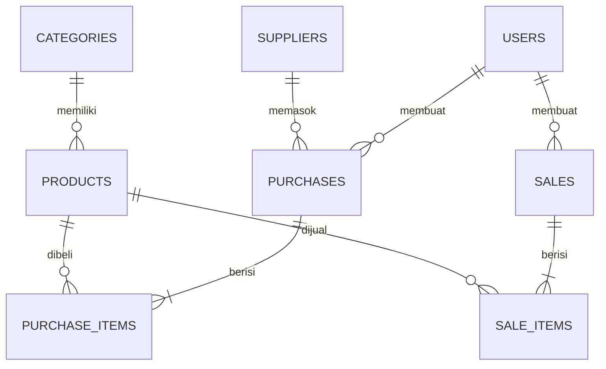

# Inventory & Sales Management System

Aplikasi web manajemen stok dan penjualan untuk toko kecil, dibuat dengan Laravel sebagai tugas UTS Web Programming 2.

## Fitur

- Login, logout, dan pembagian peran (admin dan staff)
- Admin mengelola kategori, supplier, dan produk
- Pembelian (stok masuk) dan penjualan (stok keluar) dengan banyak item
- Penjualan ditolak jika stok tidak cukup, tanpa mengubah data
- Pembatalan transaksi yang mengembalikan stok secara konsisten
- Pencarian, filter, dan pagination
- Dashboard ringkasan dari data aktual

## Kebutuhan

- PHP 8.3 atau lebih baru
- Composer
- MySQL atau MariaDB

## Cara menjalankan

1. Salin project dan masuk ke foldernya.
2. Pasang dependensi:

```bash
composer install
```

3. Salin file pengaturan dan buat kunci aplikasi:

```bash
copy .env.example .env
php artisan key:generate
```

4. Buat database kosong bernama `inventory_sales`, lalu pastikan bagian ini di file `.env`:

```
DB_CONNECTION=mysql
DB_HOST=127.0.0.1
DB_PORT=3306
DB_DATABASE=inventory_sales
DB_USERNAME=root
DB_PASSWORD=
```

5. Buat tabel dan isi data contoh:

```bash
php artisan migrate --seed
```

6. Jalankan aplikasi:

```bash
php artisan serve
```

Buka `http://127.0.0.1:8000`.

## Akun demo

| Peran | Email | Kata sandi |
|---|---|---|
| Admin | admin@example.com | password123 |
| Staff | staff@example.com | password123 |

Akun ini hanya untuk demo dan dibuat oleh seeder.

## Hak akses

| Fitur | Admin | Staff |
|---|---|---|
| Kategori, supplier, tambah/ubah/hapus produk | Ya | Tidak |
| Melihat produk | Ya | Ya |
| Membuat pembelian dan penjualan | Ya | Ya |
| Melihat semua transaksi | Ya | Hanya miliknya |
| Membatalkan transaksi | Ya | Tidak |
| Angka penjualan di dashboard | Ya | Tidak |

## Aturan bisnis

- Stok produk hanya berubah lewat pembelian, penjualan, dan pembatalan.
- Harga dan total dihitung di server, bukan dari input browser.
- Setiap transaksi dijalankan dalam `DB::transaction`, dengan baris produk dikunci memakai `lockForUpdate` untuk mencegah stok menjadi negatif.
- Transaksi selesai tidak diedit, hanya dibatalkan.
- Pembatalan pembelian ditolak jika stoknya sudah terpakai.
- Produk, supplier, dan pengguna yang sudah dipakai transaksi tidak bisa dihapus.

## ERD



## Menjalankan test

```bash
php artisan test
```

## Keterbatasan yang diketahui

- Pengguna hanya dibuat lewat seeder (admin dan staff); belum ada halaman kelola pengguna.
- Form transaksi memakai lima baris item tetap.
- Nomor transaksi dibuat dari jumlah transaksi hari itu, jadi dua permintaan yang sangat bersamaan berpotensi bentrok.
- Validasi masih ditulis langsung di controller, belum dipisah ke Form Request.

## Screenshot

Gambar disimpan di folder `docs/screenshots` (login, dashboard, produk, pembelian, penjualan, dan penolakan stok tidak cukup).